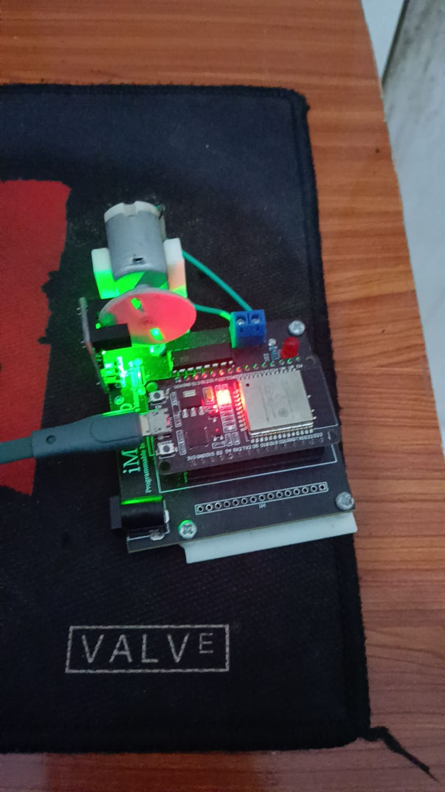
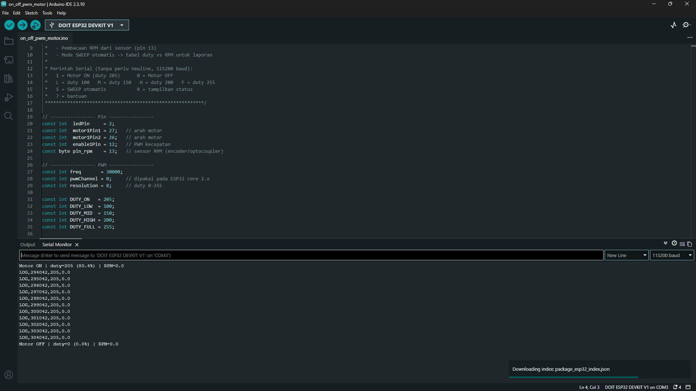
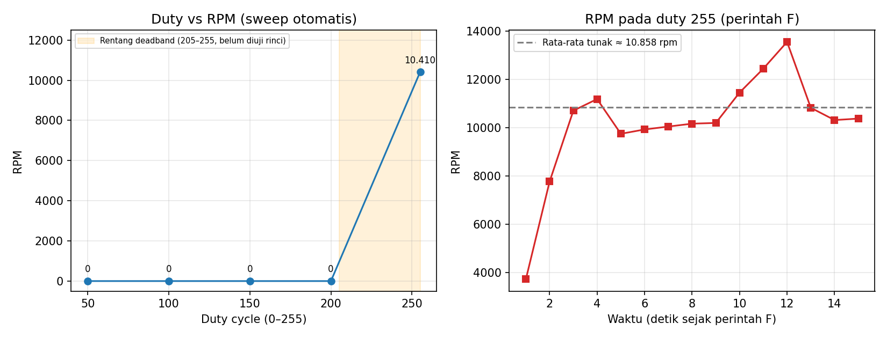
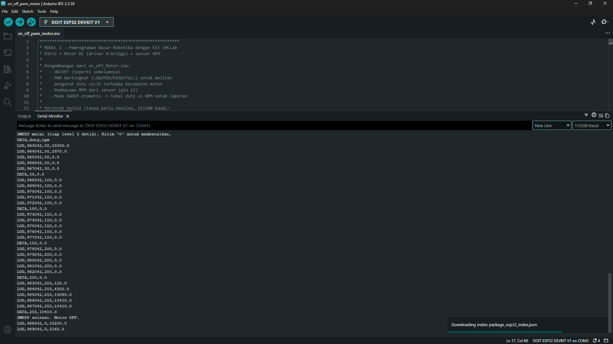

# Laporan Riset Modul 1 — Pemrograman Dasar Robotika dengan Kit iMCLab

| Nama / NIM | Effandy Perwira Dwi Putra/23081010308 |
| Kelompok | 1 |
| Tanggal percobaan | 25 Oktober 2026 |
| Kode program | `on_off_pwm_motor/on_off_pwm_motor.ino` |

## 1. Tujuan

1. Memahami pengendalian aktuator (motor DC) menggunakan ESP32 pada kit iMCLab.
2. Mengendalikan arah dan kecepatan motor dengan sinyal digital dan PWM.
3. Mengamati pengaruh duty cycle terhadap kecepatan putar (RPM).

## 2. Dasar Teori (ringkas)

- **ESP32 dan GPIO** — GPIO (General Purpose Input/Output) ESP32 dapat dikonfigurasi sebagai output untuk memberi sinyal HIGH/LOW atau sebagai input untuk membaca sinyal luar, misalnya dari sensor. Tegangan logika ESP32 adalah 3,3 V dan arus tiap pin terbatas, sehingga motor tidak boleh dihubungkan langsung ke pin GPIO melainkan lewat driver motor.
- **Driver motor (H-bridge)** — pin `IN1`/`IN2` menentukan arah putar, pin `EN` menerima PWM untuk mengatur kecepatan. Pada program ini `IN1=HIGH` dan `IN2=LOW` sehingga motor berputar satu arah (maju). [ISI: sebutkan tipe driver yang ada di kit, mis. L298N / sejenisnya — cek dokumentasi kit]
- **PWM** — kecepatan efektif ditentukan oleh duty cycle. Resolusi 8-bit berarti duty 0–255, sehingga `persen duty = duty / 255 × 100%`. Frekuensi PWM yang dipakai: 30 kHz, dibangkitkan dengan peripheral LEDC ESP32.
- **Sensor RPM** — sensor optik (menurut komentar kode: encoder/optocoupler) membaca piringan berlubang (2 lubang). Pulsa dihitung dengan interrupt pada sisi turun (`FALLING`) di GPIO 13 dengan debounce 500 µs, lalu `RPM = (pulsa / jumlah_lubang) × (60000 / selang_ms)`. Selang hitung 1 detik sehingga resolusi RPM 30 rpm per pulsa. [ISI: konfirmasi jenis sensor pada kit]
- Referensi:
  1. Espressif Systems, *ESP32 Series Datasheet*. https://www.espressif.com/sites/default/files/documentation/esp32_datasheet_en.pdf
  2. Espressif, *Arduino-ESP32 LEDC (PWM) API*. https://docs.espressif.com/projects/arduino-esp32/en/latest/api/ledc.html
  3. [ISI: modul kuliah Pengantar Robotika 2026 / buku petunjuk kit iMCLab]

## 3. Alat dan Bahan

| No | Alat/Bahan | Keterangan |
|---|---|---|
| 1 | Kit iMCLab (ESP32 + motor DC) | DOIT ESP32 DEVKIT V1 |
| 2 | Kabel USB | Menggunakan kabel USB micro |
| 3 | Laptop + Arduino IDE | versi IDE 2.3.10 dan board manager esp32 by espressif versi 2.0.11 |

## 4. Konfigurasi Pin

| Fungsi | GPIO ESP32 |
|---|---|
| Arah motor IN1 | 27 |
| Arah motor IN2 | 26 |
| Enable / PWM | 12 |
| Sensor RPM | 13 |
| LED indikator | 2 |

## 5. Prosedur

1. Hubungkan kit ke laptop, pilih board dan port di Arduino IDE.
2. Buka `on_off_pwm_motor.ino`, lalu upload.
3. Buka Serial Monitor (115200 baud; setting newline apa pun diterima).
4. Kirim perintah: `1`, `0`, `L`, `M`, `H`, `F`, `R`, lalu `S` (sweep otomatis).
5. Catat nilai duty dan RPM setiap level ke tabel pada bagian Hasil.

Perintah yang tersedia:

| Perintah | Fungsi |
|---|---|
| `1` / `0` | Motor ON (duty 205) / OFF |
| `L` `M` `H` `F` | Duty 100 / 150 / 200 / 255 |
| `S` | Sweep otomatis 50→255, tiap level 5 detik |
| `R` | Tampilkan status duty dan RPM |

## 6. Hasil Percobaan

### 6.1 Rangkaian

Diatas merupakan foto kit IMCLab yang menggunakan board ESP32 DEVKIT V1 untuk pengendali DC motor yang ada di ujung board kit.

### 6.2 Uji ON/OFF

Ketika perintah `1` dikirim, motor dijalankan dengan duty tetap 205 (80,4%), tetapi motor pada kit tetap diam: RPM terbaca 0 selama 9 detik pencatatan (`LOG` per detik) hingga perintah `0` dikirim. Karena pada duty 255 motor terbukti dapat berputar (lihat 6.3), motor tidak rusak total. Penyebab yang paling mungkin adalah duty 205 masih berada di bawah ambang minimum (deadband) yang dibutuhkan untuk mengatasi gesekan statis dan rugi tegangan pada driver, serta kemungkinan kondisi brush yang sudah aus yang menaikkan ambang tersebut.

### 6.3 Uji PWM bertingkat

| Perintah | Duty | Persen | RPM (Serial) | Pengamatan motor |
|---|---|---|---|---|
| `L` | 100 | 39,2% | 0 | Motor diam; 11 pembacaan berturut-turut bernilai 0 |
| `M` | 150 | 58,8% | 0 | Motor diam; 11 pembacaan berturut-turut bernilai 0 |
| `H` | 200 | 78,4% | 0 | Motor diam; 13 pembacaan berturut-turut bernilai 0 |
| `F` | 255 | 100% | ≈ 10.858 (rentang 9.750–13.560) | Motor berputar; RPM naik 3.720 → 7.770 → 10.710 dalam ±3 detik, lalu berfluktuasi |

Catatan: pada baris status `Level ...` yang dicetak tepat saat perintah dikirim, RPM selalu 0,0 karena nilai tersebut masih berasal dari jendela 1 detik sebelum perintah. RPM pada tabel diambil dari baris `LOG` sesudahnya. Untuk `F`, nilai tabel adalah rata-rata 12 pembacaan setelah fase percepatan (detik ke-4 sampai ke-15).

### 6.4 Sweep otomatis (`S`)

Baris `DATA,duty,rpm` dari Serial Monitor:

| Duty | RPM |
|---|---|
| 50 | 0 |
| 100 | 0 |
| 150 | 0 |
| 200 | 0 |
| 255 | 10.410 |

Pada level 255, RPM per detik adalah 120 → 6.300 → 10.080 → 10.410 → 10.410, sehingga motor membutuhkan sekitar 3 detik untuk mencapai kecepatan tunak. Pembacaan awal 2.970 rpm pada level 50 adalah sisa putaran motor dari percobaan sebelumnya (motor masih meluncur), bukan hasil duty 50; pembacaan resminya (`DATA,50,0`) adalah 0. Setelah sweep selesai dan motor dimatikan, RPM turun bertahap (10.200 → 2.160), menunjukkan motor berhenti dengan meluncur (*coasting*).

## 7. Analisis

Jawab dengan data dari Bagian 6:

1. **Bagaimana hubungan duty cycle dengan RPM — mendekati linear atau tidak?** Tidak linear. Pada duty 50, 100, 150, dan 200 RPM tetap 0, lalu pada duty 255 RPM langsung mencapai ±10.400 rpm. Hubungannya berbentuk ambang (deadband diikuti lompatan), bukan garis lurus. Data saat ini hanya memiliki satu titik di atas ambang (255), sehingga bentuk kurva di antara ambang dan 255 belum dapat dipastikan; diperlukan sweep yang lebih rapat pada rentang duty 205–255. Secara teori, setelah melewati ambang RPM akan naik seiring duty.
2. **Apakah ada duty minimum agar motor mulai berputar (deadband)? Berapa nilainya?** Ada. Motor tidak berputar pada duty 200 maupun 205 (≈ 80,4%), tetapi berputar pada duty 255. Jadi duty minimum berada di antara 205 dan 255 (>80,4% dan ≤100%). Nilai pastinya belum terukur karena duty 210–250 belum diuji.
3. **Apa perbedaan perilaku kontrol ON/OFF dengan PWM bertingkat?** Kontrol ON/OFF hanya menyalakan dan mematikan motor pada satu nilai duty tetap (perintah `1` memakai duty 205, bukan duty maksimum, sehingga pada percobaan ini motor tetap diam). PWM bertingkat memungkinkan duty diatur (100, 150, 200, 255 atau sweep) sehingga kecepatan dapat dinaikkan atau diturunkan. Namun karena adanya deadband, pada kit ini pengaturan kecepatan baru efektif pada duty di atas ambang.
4. **Apakah ketika menggunakan duty maksimal RPM DC motor stabil selalu pada kecepatan maksimal?** Tidak. Pada duty 255 motor butuh ±3 detik untuk mencapai kecepatan tunak, lalu RPM masih berfluktuasi: pada perintah `F` setelah fase percepatan RPM berkisar 9.750–13.560 dengan rata-rata ≈ 10.858 rpm dan simpangan baku ≈ 1.100 rpm (selisih puncak ke puncak ≈ 35% dari rata-rata). Pada sweep, dua pembacaan terakhir stabil di 10.410 rpm. Fluktuasi tidak mungkin hanya karena kuantisasi (resolusi 30 rpm per pulsa), sehingga kemungkinan penyebabnya adalah ketidakrataan kontak brush/komutator, variasi tegangan suplai, dan derau pada sensor.

## 8. Kendala dan Solusi

| Kendala | Solusi |
|---|---|
| Kendala DC motor tidak menyala ketika cycle rendah | Melakukan 'bump start', yaitu memulai dengan cycle tinggi lalu menurunkan secara perlahan |
| Motor tidak berputar pada duty 100–205 sehingga tabel RPM bernilai 0 | Menggunakan duty 255 untuk mendapatkan RPM terukur; menguji duty 210–250 untuk menentukan batas deadband |
| RPM pada duty 255 berfluktuasi (9.750–13.560 rpm) | Mengambil rata-rata pembacaan setelah fase percepatan, dan memakai pembacaan tunak pada sweep |
| Pembacaan RPM awal sweep (2.970) bukan milik duty 50 | Menunggu motor berhenti sebelum memulai sweep |

## 9. Kesimpulan

Kit iMCLab berhasil dikendalikan dari ESP32 melalui Serial Monitor, termasuk pengaturan duty PWM dan pembacaan RPM. Pada percobaan ini motor tidak berputar pada duty 50–205 dan baru berputar pada duty 255 dengan RPM tunak ≈ 10.400–10.900 rpm, sehingga hubungan duty–RPM tidak linear karena adanya deadband antara duty 205 dan 255. RPM pada duty maksimal juga tidak sepenuhnya stabil (9.750–13.560 rpm) dan membutuhkan ±3 detik untuk mencapai kecepatan tunak. Untuk percobaan lanjutan, disarankan sweep yang lebih rapat pada duty 205–255 untuk menentukan batas deadband secara pasti.

## 10. Lampiran

- Kode: [ISI: link ke file di GitHub]
- Data mentah Serial Monitor: https://docs.google.com/spreadsheets/d/1j6fFbrsKgd5nz7lfzjtFwyn8h6M54IwheGO-RL0WSB8/edit?usp=sharing
