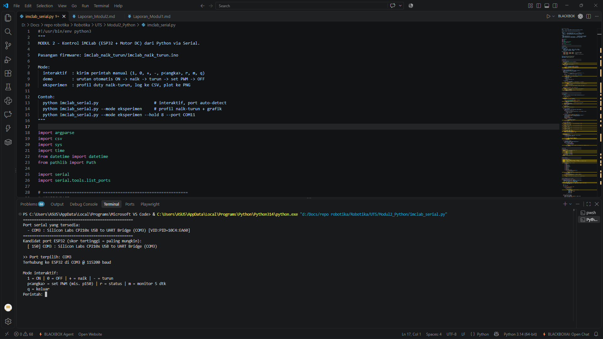
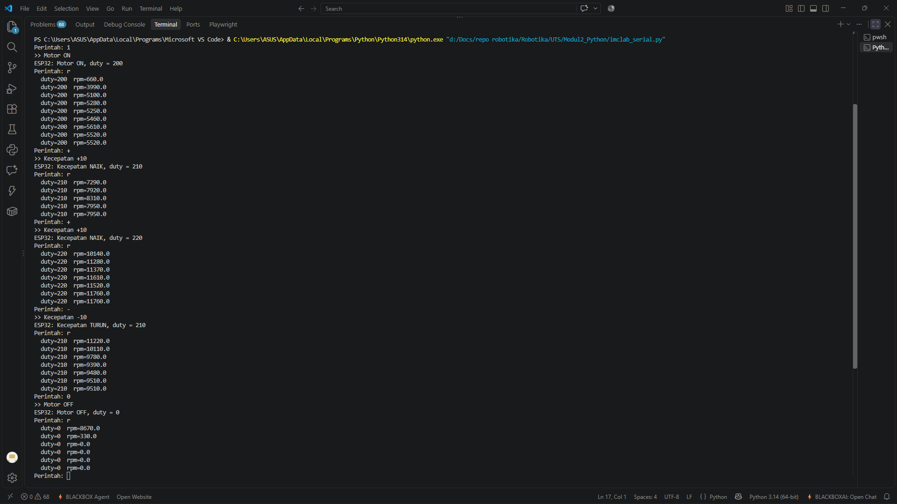
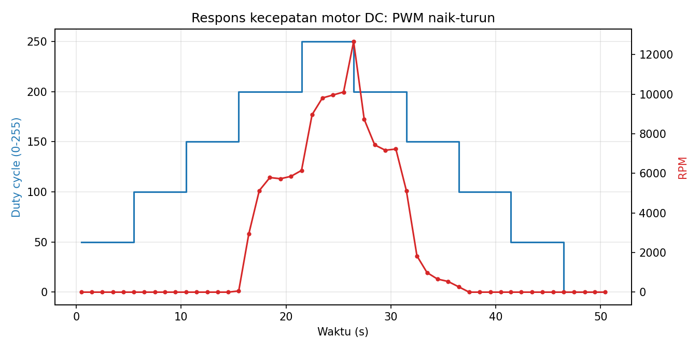
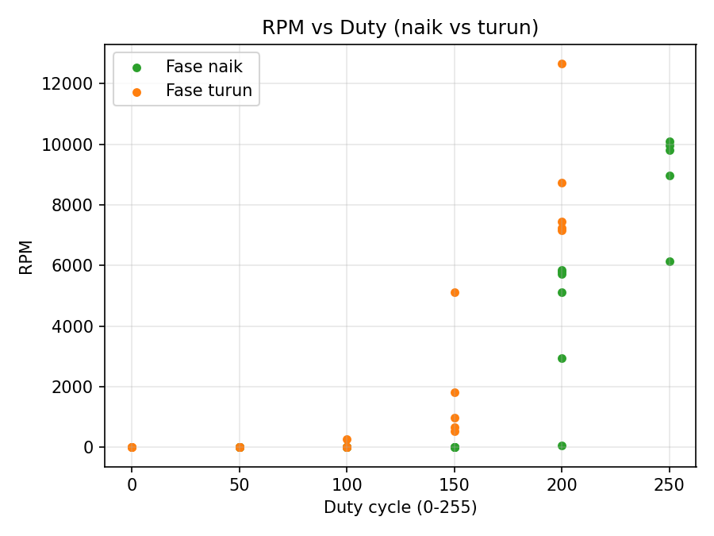

# Laporan Riset Modul 2 — Pemrograman iMCLab dengan Python

| Nama / NIM | Effandy Perwira Dwi Putra/23081010308 |
| Kelompok | 1 |
| Tanggal percobaan | 25 Oktober 2026 |
| Kode program | `imclab_naik_turun/imclab_naik_turun.ino`, `imclab_serial.py` |

## 1. Tujuan

1. Mengendalikan motor DC pada iMCLab dari komputer menggunakan Python melalui komunikasi serial.
2. Membuat percobaan otomatis kecepatan motor naik dan turun, serta merekam datanya.
3. Menganalisis respons RPM terhadap perubahan PWM dari data yang terekam.

## 2. Dasar Teori (ringkas)

- **Komunikasi serial (UART)** — UART mengirim data bit demi bit secara asinkron (tanpa sinyal clock) sehingga kedua sisi harus memakai baud rate yang sama. Pada percobaan ini dipakai baud rate 115200 dengan format 8N1 (8 bit data, tanpa paritas, 1 stop bit). Kabel USB micro terhubung ke chip USB-to-UART CP210x pada board, yang muncul sebagai port COM di komputer.
- **Protokol perintah** — komputer mengirim teks berakhiran newline; ESP32 membalas teks. Data pengukuran dikirim dalam format `DATA,<ms>,<duty>,<rpm>` tiap 1 detik agar mudah di-parse.
- **PySerial** — library Python untuk akses port serial. Fungsi yang dipakai: `serial.Serial(port, baudrate, timeout)` untuk membuka port, `write()` untuk mengirim byte, `readline()` untuk membaca satu baris, `in_waiting` untuk jumlah byte yang menunggu di buffer, serta `reset_input_buffer()` untuk membuang data lama.
- **Pengolahan data** — CSV dan matplotlib untuk grafik.
- Referensi:
  1. pySerial Documentation. https://pyserial.readthedocs.io
  2. Matplotlib Documentation. https://matplotlib.org/stable/
  3. Espressif Systems, *ESP32 Series Datasheet*. https://www.espressif.com/sites/default/files/documentation/esp32_datasheet_en.pdf

## 3. Alat dan Bahan

| No | Alat/Bahan | Keterangan |
|---|---|---|
| 1 | Kit iMCLab (ESP32 + motor DC) | DOIT ESP32 DEVKIT V1 |
| 2 | Python | 3.11.9 |
| 3 | Library | `pyserial`, `matplotlib` (`pip install -r requirements.txt`) |

## 4. Protokol Perintah

| Perintah (+`\n`) | Fungsi |
|---|---|
| `1` / `0` | Motor ON (duty saat ini; jika 0 maka default 200) / OFF |
| `+` / `-` | Duty ±10 |
| `PWM:xxx` | Set duty langsung 0–255 |
| `R` | Minta satu baris DATA |

## 5. Prosedur

1. Upload `imclab_naik_turun.ino` ke ESP32.
2. **Tutup Serial Monitor Arduino IDE** (port tidak bisa dipakai dua program sekaligus).
3. Jalankan `python imclab_serial.py` (mode interaktif, port terdeteksi otomatis).
4. Jalankan `python imclab_serial.py --mode demo`.
5. Jalankan `python imclab_serial.py --mode eksperimen --hold 5`
   (profil duty: 50→100→150→200→250 lalu 200→150→100→50→0, tiap langkah 5 detik).
6. Gunakan file CSV dan PNG di folder `data/` untuk analisis.

## 6. Hasil Percobaan

### 6.1 Deteksi port otomatis

Berhasil mendeteksi port dan memilih port yang tersambung dengan kit (port COM3).

### 6.2 Mode interaktif dan demo

Semua perintah berhasil terkirim tanpa keterlambatan.

### 6.3 Eksperimen naik-turun

| Parameter | Nilai |
|---|---|
| Durasi tiap langkah | 5 detik |
| Jumlah langkah | 10 (total ±50 detik, 50 sampel) |
| File data | `eksperimen_naik_turun_20261025_220857.csv` |

Ringkasan rata-rata RPM per langkah (dari keluaran script, sampel pertama tiap langkah diabaikan sebagai transien):

| Fase | Duty | RPM rata-rata |
|---|---|---|
| naik | 50 | 0,0 |
| naik | 100 | 0,0 |
| naik | 150 | 0,0 |
| naik | 200 | 5.088,0 |
| naik | 250 | 9.712,5 |
| turun | 200 | 7.642,5 |
| turun | 150 | 1.005,0 |
| turun | 100 | 0,0 |
| turun | 50 | 0,0 |
| turun | 0 | 0,0 |

Rata-rata di atas masih memuat sisa transien. Nilai mendekati tunak (rata-rata 3 sampel terakhir tiap langkah) adalah: naik 200 ≈ 5.790 rpm, naik 250 ≈ 9.960 rpm, turun 200 ≈ 7.280 rpm, turun 150 ≈ 730 rpm (masih meluruh).

Respons per detik pada tiap langkah yang menunjukkan motor bergerak:

| Langkah | RPM tiap detik (sampel 1–5) |
|---|---|
| naik 200 | 60 → 2.940 → 5.130 → 5.790 → 5.730 → 5.850 |
| naik 250 | 6.150 → 8.970 → 9.810 → 9.960 → 10.110 |
| turun 200 | 12.660 → 8.730 → 7.440 → 7.170 → 7.230 |
| turun 150 | 5.130 → 1.830 → 990 → 660 → 540 |
| turun 100 | 270 → 0 → 0 → 0 → 0 |

## 7. Analisis

1. **Berapa lama RPM mencapai nilai stabil setelah duty berubah (waktu tunak)? Bedakan saat naik dan turun.** Saat motor sedang berputar, waktu tunaknya sekitar 3–4 detik, baik naik maupun turun. Naik 150→200 mencapai ±99% nilai akhir (≈5.790 rpm) pada detik ke-4, dan naik 200→250 mencapai ±98% (9.810 dari ≈9.960 rpm) pada detik ke-3. Turun 250→200 mencapai sekitar 7.440 rpm (±3% dari ≈7.200 rpm) pada detik ke-3. Pengecualian adalah penurunan ke duty 150: RPM tidak menuju nilai tunak baru, melainkan meluruh 5.130 → 540 rpm selama 5 detik karena motor tidak lagi digerakkan, dan pada duty 100 RPM jatuh ke 0 dalam 1–2 detik. Resolusi waktu pengukuran hanya 1 detik, sehingga angka di atas berketelitian ±1 detik.
2. **Apakah RPM pada duty yang sama berbeda antara fase naik dan turun (histeresis)?** Ya, dan perbedaannya besar, bukan hanya ratusan rpm. Pada duty 200, RPM tunak fase naik ≈ 5.790 rpm sedangkan fase turun ≈ 7.280 rpm, selisih ≈ 1.500 rpm (fase turun ±26% lebih tinggi). Pada duty 150 perbedaannya lebih ekstrem: fase naik 0 rpm, sedangkan fase turun masih berputar (5.130 rpm pada detik pertama, meluruh ke 540 rpm) karena inersia. Hal ini sesuai dengan gesekan statis yang lebih besar daripada gesekan dinamis sehingga untuk mulai berputar dibutuhkan duty lebih tinggi daripada untuk mempertahankan putaran, ditambah efek inersia rotor.
3. **Pada duty berapa motor mulai/berhenti berputar?** Fase naik: motor tidak berputar pada duty 50, 100, 150 dan mulai berputar pada duty 200 (batas berada di antara 151–200; nilai pastinya belum diuji). Fase turun: pada duty 150 motor sudah tidak digerakkan lagi dan RPM meluruh ke ±540 rpm, lalu pada duty 100 RPM menjadi 0 dalam 1–2 detik. Jadi motor berhenti sepenuhnya pada duty 100, dengan batas penggerakan efektif di antara 150–200. Catatan: pada Modul 1 duty 200 dan 205 tidak memutar motor, sedangkan pada Modul 2 duty 200 memutar motor. Batas deadband tampaknya bergeser antar sesi percobaan (dugaan: kondisi motor/brush, suhu, atau tegangan suplai yang berbeda), sehingga nilainya tidak boleh dianggap konstan.
4. **Apa keunggulan mengendalikan lewat Python dibanding mengetik manual di Serial Monitor?** Python memungkinkan percobaan otomatis dengan waktu yang konsisten (profil 10 langkah × 5 detik berjalan sendiri tanpa mengetik), pencatatan data langsung ke CSV berstempel waktu, pembuatan grafik dan ringkasan otomatis, serta deteksi port otomatis. Hasilnya lebih mudah diulang dan dianalisis. Perlu dicatat bahwa kemampuan memilih duty secara detail (`PWM:xxx`) sebenarnya juga tersedia di Serial Monitor, sehingga keunggulan Python terutama pada otomatisasi dan perekaman data, bukan pada presisi nilai.

## 8. Kendala dan Solusi

| Kendala | Solusi |
|---|---|
| Kendala DC motor tidak menyala ketika cycle rendah | Melakukan 'bump start', yaitu memulai dengan cycle tinggi lalu menurunkan secara perlahan (pada data ini motor tetap berhenti pada duty ≤150 walaupun sebelumnya sudah berputar) |
| Sampel pertama tiap langkah masih berisi sisa respons langkah sebelumnya (mis. 12.660 rpm pada awal turun 200) | Script mengabaikan sampel pertama tiap langkah saat menghitung rata-rata RPM |
| RPM tiap detik berfluktuasi dan hanya berresolusi 30 rpm per pulsa | Memakai rata-rata beberapa sampel pada kondisi mendekati tunak |

## 9. Kesimpulan

Motor iMCLab berhasil dikendalikan dari Python melalui serial, dan percobaan naik-turun otomatis menghasilkan data CSV serta grafik tanpa perlu pengetikan manual. Motor baru berputar pada duty 200 saat fase naik dan berhenti sepenuhnya pada duty 100 saat fase turun, dengan waktu tunak sekitar 3–4 detik. Terdapat histeresis yang jelas: pada duty 200 RPM fase turun (≈7.280 rpm) lebih tinggi sekitar 1.500 rpm daripada fase naik (≈5.790 rpm) akibat gesekan dan inersia. Batas deadband yang berbeda dari Modul 1 menunjukkan bahwa ambang ini dapat berubah antar sesi, sehingga disarankan uji ulang dengan langkah duty yang lebih rapat.

## 10. Lampiran

- Kode: [ISI: link GitHub]
- Data mentah: `data/eksperimen_naik_turun_20261025_220857.csv`
