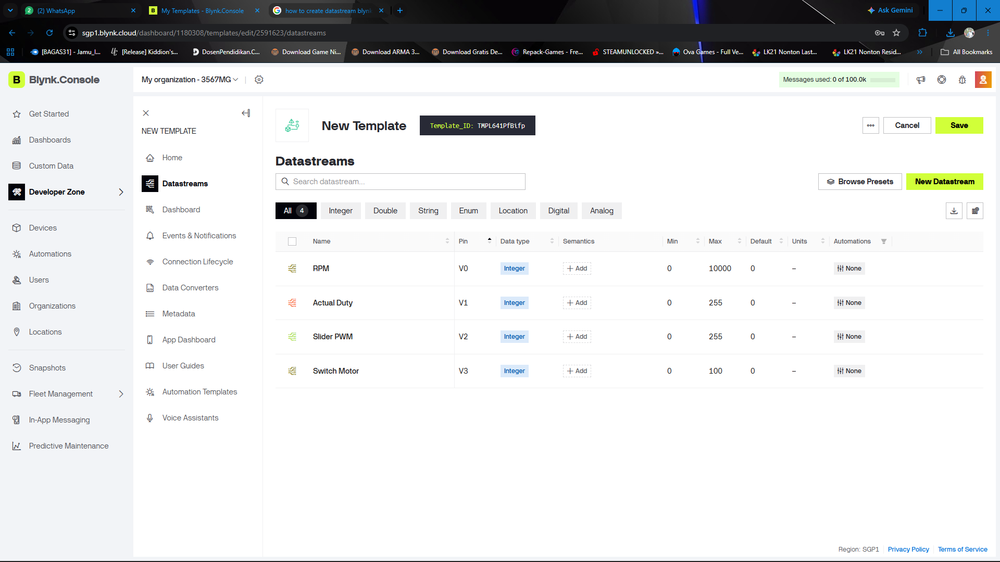
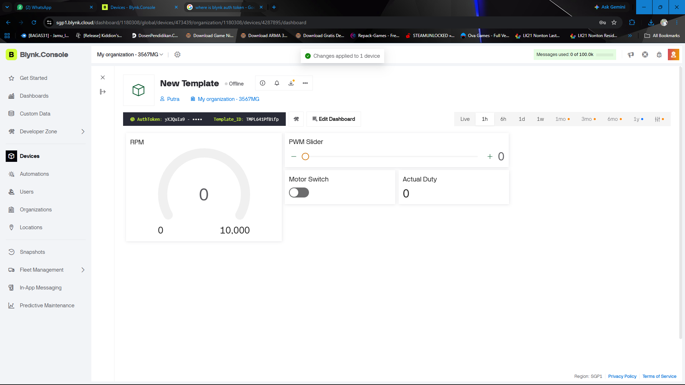
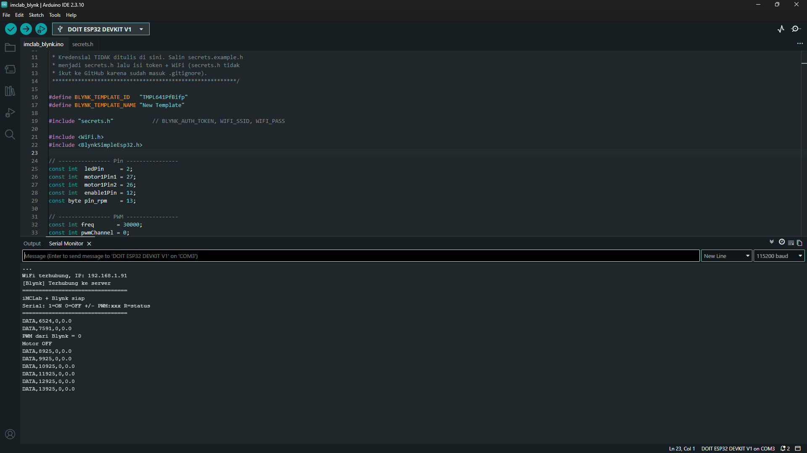
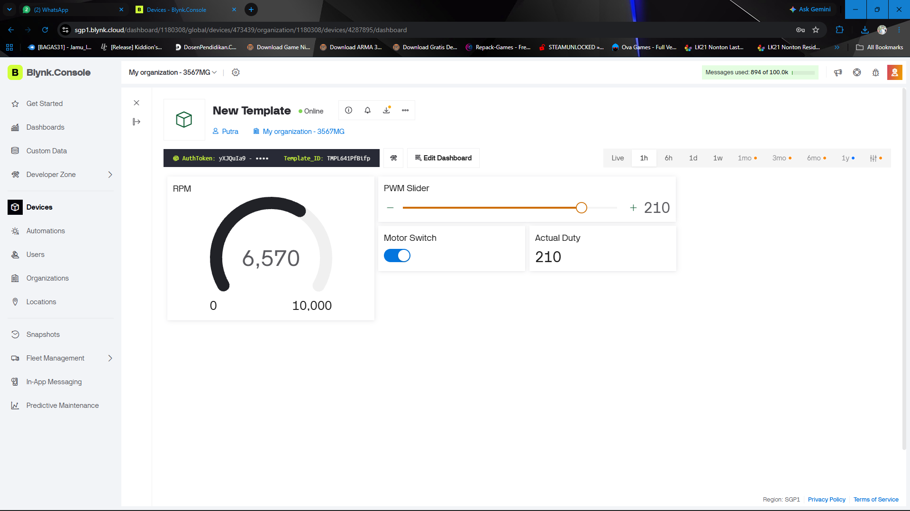
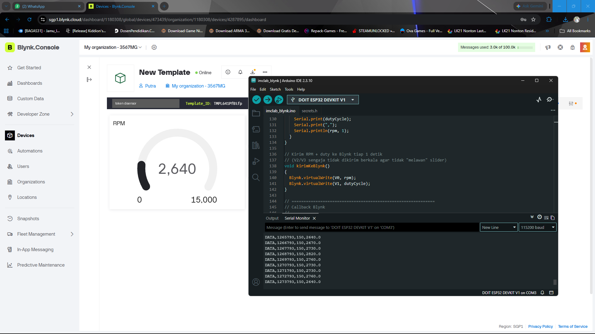
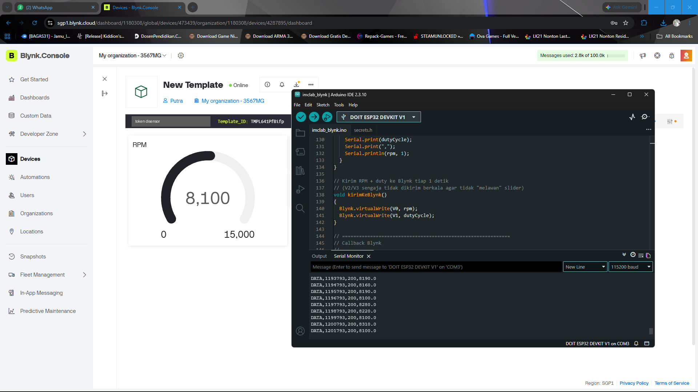
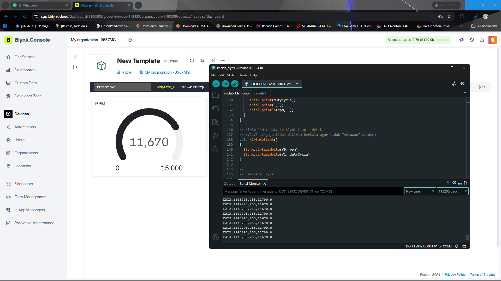
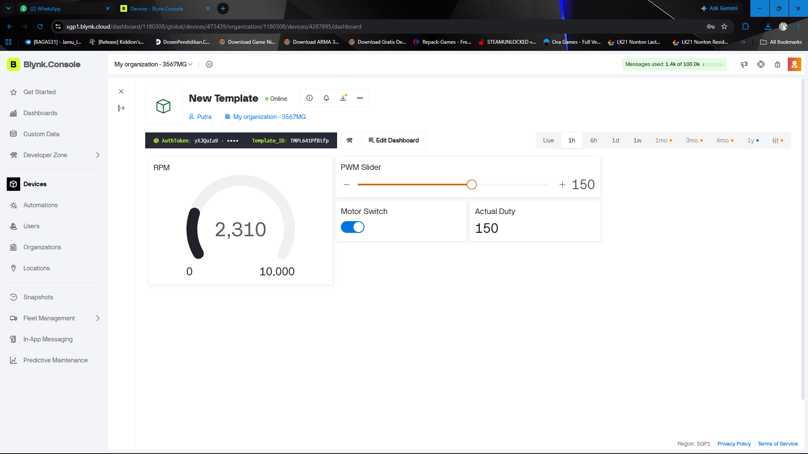

# Laporan Riset Modul 3 — Pemrograman iMCLab Berbasis Blynk

| Nama / NIM | Effandy Perwira Dwi Putra/23081010308 |
| Kelompok | 1 |
| Tanggal percobaan | 25 Oktober 2026 |
| Kode program | `imclab_blynk/imclab_blynk.ino` |

## 1. Tujuan

1. Menghubungkan iMCLab (ESP32) ke platform IoT Blynk melalui WiFi.
2. Mengendalikan ON/OFF dan kecepatan (PWM) motor dari aplikasi Blynk.
3. Memantau RPM motor secara real-time pada dashboard.

## 2. Dasar Teori (ringkas)

- **IoT dan Blynk** — Internet of Things (IoT) adalah konsep menghubungkan perangkat fisik ke jaringan internet sehingga dapat dipantau dan dikendalikan dari jarak jauh. Blynk adalah platform IoT berbasis cloud yang menghubungkan mikrokontroler seperti ESP32 dengan dashboard web dan aplikasi mobile tanpa perlu membuat server sendiri. Perangkat dikenali oleh server melalui token autentikasi (`BLYNK_AUTH_TOKEN`) yang bersifat rahasia.
- **Template, Device, Datastream, Dashboard** —
  - *Template* adalah cetak biru yang menyimpan definisi datastream, tampilan dashboard, dan pengaturan lain untuk sekelompok perangkat sejenis.
  - *Device* adalah satu perangkat nyata (di sini satu kit iMCLab) yang dibuat dari template dan memiliki token sendiri.
  - *Datastream* adalah saluran data bertipe tertentu (nama, virtual pin, tipe data, nilai minimum/maksimum) yang menjadi jalur pertukaran nilai antara perangkat dan widget.
  - *Dashboard* adalah tampilan widget (gauge, slider, switch, label, chart) yang terhubung ke datastream, sehingga pengguna dapat melihat data dan mengirim perintah.
- **Virtual Pin** — `BLYNK_WRITE(Vx)` dipanggil saat widget mengirim nilai ke ESP32; `Blynk.virtualWrite(Vx, nilai)` mengirim nilai dari ESP32 ke widget.
- Referensi:
  1. Blynk Documentation. https://docs.blynk.io
  2. Blynk Library untuk Arduino/ESP32. https://github.com/blynkkk/blynk-library
  3. Espressif Systems, *ESP32 Series Datasheet*. https://www.espressif.com/sites/default/files/documentation/esp32_datasheet_en.pdf

## 3. Alat dan Bahan

| No | Alat/Bahan | Keterangan |
|---|---|---|
| 1 | Kit iMCLab (ESP32 + motor DC) | DOIT ESP32 DEVKIT V1 |
| 2 | Akun Blynk + aplikasi (web/mobile) | Blynk.Console (web), region SGP1 |
| 3 | Jaringan WiFi 2,4 GHz | KOS MA15 2.4 |
| 4 | Library Blynk | Versi 1.3.5 |

## 4. Konfigurasi Blynk

| Virtual Pin | Nama datastream | Tipe | Rentang | Arah | Widget |
|---|---|---|---|---|---|
| V0 | RPM | Integer | 0–10000 | ESP32 → Blynk | Gauge |
| V1 | Actual Duty | Integer | 0–255 | ESP32 → Blynk | Label |
| V2 | Slider PWM | Integer | 0–255 | Blynk ⇄ ESP32 | Slider |
| V3 | Switch Motor | Integer | 0–1 (di console diatur 0–100) | Blynk ⇄ ESP32 | Switch |

V2 dan V3 bersifat dua arah: widget mengirim perintah ke ESP32, dan ESP32 menulis balik nilai aktual (`applyMotor()`) agar slider dan switch selalu sesuai kondisi motor, misalnya saat motor diubah lewat Serial.

## 5. Prosedur

1. Buat template dan datastream sesuai tabel di atas, lalu tambahkan device.
2. Salin `secrets.example.h` menjadi `secrets.h`, isi token dan WiFi (jangan di-commit).
3. Upload `imclab_blynk.ino`, buka Serial Monitor 115200 baud.
4. Pastikan muncul `WiFi terhubung` dan `[Blynk] Terhubung ke server`.
5. Uji switch, slider, dan pengamatan RPM di dashboard.

## 6. Hasil Percobaan

### 6.1 Koneksi

Serial Monitor menampilkan `WiFi terhubung` (IP lokal 192.168.1.91) dan `[Blynk] Terhubung ke server`, dan status device di Blynk.Console berubah menjadi *Online*. Baris `DATA` pertama muncul pada `millis()` = 6524, artinya proses `setup()` (WiFi + koneksi Blynk) selesai ±6,5 detik setelah board menyala. Koneksi WiFi sendiri tampak cepat (±1 detik, tiga titik progres × 250 ms), sehingga sebagian besar waktu dipakai untuk menyambung ke server Blynk.

Segera setelah terhubung, muncul `PWM dari Blynk = 0` dan `Motor OFF`. Dua baris ini berasal dari `syncVirtual(V2)` dan `syncVirtual(V3)` di `BLYNK_CONNECTED()`, yaitu ESP32 mengambil nilai terakhir slider dan switch dari server.

### 6.2 Uji switch ON/OFF

Pada gambar di atas switch dalam kondisi ON, slider dan Actual Duty menunjukkan 210, dan gauge RPM menunjukkan 6.570. Kondisi OFF terlihat pada Serial Monitor (`Motor OFF`, RPM 0) dan pada dashboard dengan switch mati serta slider 0 (`02_dashboard.png`). Jika switch dinyalakan saat duty masih 0, firmware memberi duty default 200; jika dimatikan, duty menjadi 0.

Kontrol switch dan PWM melalui Blynk tidak menunjukkan adanya delay yang mengganggu, delay dari kontrol Blynk hingga ke respon kit hanya sekitar 1 detik.

### 6.3 Uji slider PWM

| Nilai slider | RPM di dashboard | RPM di Serial | Selisih |
|---|---|---|---|
| 0 | 0 | 0 | 0 |
| 100 | 0 | 0 | 0 |
| 150 | 2640 | 2640 | 0 |
| 200 | 8100 | 8100 | 0 |
| 255 | 11670 | 11670 | 0 |

*Data dari Blynk terkadang ada sedikit delay akan tetapi masih selalu mengikuti data selanjutnya yang ditampilkan serial.*

Nilai di Serial berfluktuasi dari detik ke detik, misalnya 2.640–2.820 rpm pada duty 150, 8.100–8.310 rpm pada duty 200, dan 11.670–11.700 rpm pada duty 255. Dashboard menampilkan salah satu nilai tersebut sesuai saat data terakhir dikirim. Pada percobaan lain dengan slider 150, dashboard menunjukkan 2.310 rpm (`05_chart_rpm.png`).

### 6.4 Uji ketahanan koneksi (opsional)

| Skenario | Hasil |
|---|---|
| Kit dimatikan (dicabut dari power) lalu dinyalakan | Kit berhasil menyambung kembali ke WIFI secara otomatis |
| Kontrol lewat Serial saat WiFi putus | Tidak bisa |

## 7. Analisis

Jawab dengan data dari Bagian 6:

1. **Berapa kira-kira latensi dari perintah di aplikasi ke respons motor? Apa yang memengaruhinya?** Latensi yang teramati sekitar 1 detik. Jalur perintah melewati WiFi, internet, dan server cloud Blynk (region SGP1), lalu `BLYNK_WRITE` langsung mengubah duty tanpa menunggu timer, sehingga penundaan perintah terutama berasal dari jaringan dan server. Untuk tampilan RPM, ada tambahan keterlambatan hingga ±1 detik karena RPM dihitung per 1 detik (`hitungRPM`) dan dikirim ke Blynk oleh timer 1 detik (`kirimKeBlynk`) yang tidak disinkronkan. Selain itu motor sendiri butuh ±3–4 detik untuk mencapai RPM tunak (Modul 2), sehingga perubahan RPM di gauge tampak lebih lambat daripada perubahan perintahnya.
2. **Apakah RPM di dashboard sama dengan di Serial Monitor? Mengapa bisa berbeda?** Sama. Pada ketiga uji (150, 200, 255), dashboard dan baris `DATA` terakhir identik (2.640, 8.100, dan 11.670 rpm). Keduanya membaca variabel `rpm` yang sama dari firmware, bukan dari Serial Monitor. Perbedaan sesaat bisa muncul karena RPM dikirim ke Blynk dengan timer terpisah (nilai di dashboard bisa tertinggal hingga 1 detik dari baris Serial) dan karena keterlambatan jaringan, sedangkan RPM sendiri berfluktuasi tiap detik.
3. **Apa kelebihan dan kekurangan kendali via Blynk dibanding Serial/Python (Modul 2)?** Kelebihan: antarmuka ramah pengguna (slider, switch, gauge), dapat diakses dari ponsel atau browser tanpa kabel USB, dan dapat dipantau dari jarak jauh. Kekurangan: setup lebih rumit bagi yang belum pernah memakai Blynk (template, datastream, token, WiFi), bergantung pada WiFi/internet dan server cloud, latensi sekitar 1 detik dengan resolusi data 1 detik, tidak ada perekaman data otomatis ke CSV seperti pada Python, serta ada kuota pesan (pada percobaan ini terpakai ±3 ribu dari 100 ribu).
4. **Mengapa perlu sinkronisasi (`syncVirtual`, `virtualWrite` ke V2/V3) saat device tersambung kembali?** Widget Blynk menyimpan nilai terakhir di server, sedangkan ESP32 mulai dari kondisi motor mati setelah restart atau putus koneksi. `syncVirtual(V2)` dan `syncVirtual(V3)` meminta nilai terakhir slider dan switch dari server sehingga motor kembali ke kondisi yang ditampilkan dashboard (terlihat pada Serial: `PWM dari Blynk = 0`, `Motor OFF`). Sebaliknya, `virtualWrite` ke V1/V2/V3 di `applyMotor()` memperbarui widget agar mengikuti kondisi motor sebenarnya, misalnya bila motor diubah lewat Serial. Tanpa sinkronisasi dua arah, dashboard dan motor bisa berbeda kondisi. Konsekuensinya, jika terakhir motor dalam keadaan ON, motor akan langsung menyala kembali saat perangkat tersambung, sehingga perlu kehati-hatian.

## 8. Kendala dan Solusi

| Kendala | Solusi |
|---|---|
| WIFI 5Ghz tidak terdeteksi oleh kit | Menggunakan wifi 2.4ghz |
| RPM pada duty 255 (±11.700) melebihi rentang gauge/datastream 10.000 | Rentang gauge diperbesar menjadi 15.000 pada datastream (terlihat pada screenshot uji 150/200/255) |
| Motor tidak berputar pada slider 100 (RPM 0) | Menggunakan duty ≥150 untuk pengamatan RPM (lihat deadband pada Modul 1 dan 2) |

## 9. Kesimpulan

iMCLab berhasil dihubungkan ke Blynk melalui WiFi 2,4 GHz, dan motor dapat dikendalikan (ON/OFF dan PWM) serta RPM dipantau secara real-time dari dashboard dengan latensi sekitar 1 detik. Nilai RPM di dashboard identik dengan di Serial Monitor pada duty 150, 200, dan 255 (2.640, 8.100, dan 11.670 rpm). Sinkronisasi `syncVirtual` dan `virtualWrite` menjaga kondisi dashboard dan motor tetap sama setelah koneksi ulang. Kendali via Blynk lebih mudah dipakai dan dapat dilakukan dari jarak jauh, tetapi bergantung pada jaringan dan server cloud serta tidak merekam data sedetail Python.

## 10. Lampiran

- Kode: [ISI: link GitHub] (tanpa `secrets.h`)
